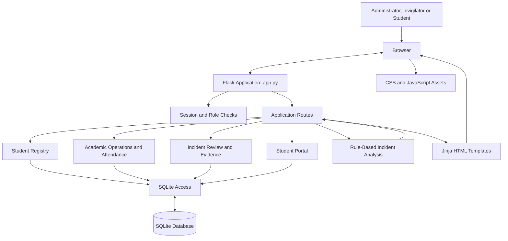

# Examination Integrity Management System (EIMS)

A developing Flask-based university examination operations platform with student registry, academic enrolment, examination sessions, attendance, student self-service, and evidence-controlled incident review workflows.

**Project status:** Operational application under PostgreSQL runtime validation; institutional production acceptance remains outstanding  
**Stack:** Python · Flask · SQLite (local development) / PostgreSQL (runtime integration under test) · HTML · CSS · JavaScript  
**Repository:** [Moana-star/AI_INTEGRITY](https://github.com/Moana-star/AI_INTEGRITY)

> **Operational data policy:** Fresh database initialization is empty by default. No fictional students, examinations or incidents are inserted unless the explicit `--demo` option is used. Use institution-authorized records only in an approved environment. Production release remains gated on PostgreSQL runtime verification, security review, backup recovery and university approval. Incident review indicators are rule-based and are not proof of misconduct or automated disciplinary decisions.

## Contents

- [Overview](#overview)
- [Features](#features)
- [Architecture](#architecture)
- [Technology stack](#technology-stack)
- [Setup and installation](#setup-and-installation)
- [Initial administrator provisioning](#initial-administrator-provisioning)
- [Incident review categories](#incident-review-categories)
- [Security and limitations](#security-and-limitations)
- [Testing](#testing)
- [Institutional development](#institutional-development)
- [Production readiness](docs/PRODUCTION_READINESS.md)
- [Kisii University examination policy mapping](docs/KISII_UNIVERSITY_POLICY_MAPPING.md)
- [Kisii University integration readiness](docs/KISII_UNIVERSITY_INTEGRATION_READINESS.md)
- [PostgreSQL migration and production runbook](docs/POSTGRESQL_MIGRATION_AND_PRODUCTION_RUNBOOK.md)
- [Institutional integration and production acceptance](docs/INSTITUTIONAL_INTEGRATION_AND_PRODUCTION_ACCEPTANCE.md)
- [Self-hosted PostgreSQL deployment](docs/SELF_HOSTED_DEPLOYMENT.md)
- [Future improvements](#future-improvements)
- [Author](#author)

## Overview

EIMS is being expanded into a university examination operations platform. The current feature branch adds administrator-managed student records, academic unit enrolment, examination sessions, eligible candidate lists, venue capacity checks, invigilator assignments, manual/student-card attendance, a student portal, and evidence-controlled incident review. These workflows are an implementation increment and still require local end-to-end verification and institutional security review.

The analysis feature applies explicit rules to recorded incident data. Despite the interface's AI-analysis wording, **the current implementation does not use artificial intelligence, machine learning, or a trained predictive model**.

## Features

- **Five-role access foundation:** administrator, registrar, examination officer, invigilator and student workflows use separate authentication and role checks. Staff accounts are provisioned by an administrator; public staff self-registration is disabled.
- **Student management:** maintain student records used by examination and incident workflows.
- **Institutional student registry (initial increment):** maintain admission-number-based profiles, academic placement, institutional contact fields, and academic status; import authorized UTF-8 CSV records.
- **Academic operations:** create academic units, enrol students, create examination sessions, derive candidate lists from enrolments, check venue capacity and timetable overlaps, and assign invigilators. A session cannot be activated without an active venue and at least two active invigilators.
- **Kisii policy-gated eligibility:** versioned policy drafts, independent approval, evidence records for course registration, fees, lecture attendance and CAT participation. Missing evidence remains pending; attendance is not a substitute for eligibility.
- **Attendance and identity:** session-level check-in/check-out using manual or student-card checks, duplicate-event prevention, seat labels, audit events and a preview-only camera interface. Live facial recognition is disabled.
- **Student portal:** administrator-provisioned student access, forced temporary-password change, personal academic and examination views, incident responses, independent incident appeals and Senate verdict review requests within the recorded 21-day period.
- **Incident investigations:** case workflow statuses, reviewer notes, restricted evidence uploads, SHA-256 checksums, and audited evidence downloads.
- **Examination management:** manage examination details, schedules, venues, statuses, and invigilator assignments.
- **Invigilator management:** maintain invigilator details and status.
- **Incident reporting:** record incidents against students and examinations, including descriptions, severity, and status.
- **Incident review:** administrators can manage case workflow statuses, record review notes, and view student responses. Evidence files are stored outside the public static directory.
- **Explainable incident analysis:** categorize recorded incident patterns using explicit rules and show a reason for each category.
- **Dashboards and reports:** present examination, incident, and record summaries.
- **Local persistence:** store development data in SQLite. Production startup is deliberately blocked until the PostgreSQL migration is complete and verified.

## Architecture

The application uses a modular Flask server-rendered architecture:



This is a high-level view of the current codebase, not a production deployment diagram.

### Repository structure

```text
AI_INTEGRITY/
├── app.py                    # Flask routes and application logic
├── requirements.txt          # Python dependency declaration
├── database/
│   └── database.py           # Empty-first schema initialization; optional demo seeding
├── modules/
│   ├── access_control.py         # Staff role policy and migration
│   ├── institutional_registry.py # Student registry and academic history
│   ├── operations.py             # Academic units, sessions and attendance
│   ├── eligibility.py            # Kisii policy and eligibility evidence
│   ├── appeals.py                # Incident appeals and Senate reviews
│   ├── identity_check.py         # Session identity and camera preview
│   ├── integrity.py              # Incident case review and evidence
│   └── student_portal.py         # Student self-service and responses
├── docs/
│   ├── ARCHITECTURE.md       # Architecture notes
│   ├── DATA_GOVERNANCE.md    # Privacy and biometric safeguards
│   ├── INSTITUTIONAL_ROADMAP.md # Phased institutional development
│   ├── PRODUCTION_READINESS.md # Go-live requirements and blockers
│   ├── KISII_UNIVERSITY_POLICY_MAPPING.md # Public rule sources and policy mapping
│   ├── KISII_UNIVERSITY_INTEGRATION_READINESS.md # SIS/SSO integration prerequisites
│   ├── POSTGRESQL_MIGRATION_AND_PRODUCTION_RUNBOOK.md # Migration and release gates
│   └── TESTING.md            # Automated and manual test guidance
├── tests/
│   ├── test_institutional_registry.py
│   ├── test_academic_operations.py
│   └── test_integrity_and_student_portal.py
├── .github/workflows/
│   └── tests.yml             # Python test workflow
├── static/
│   ├── css/style.css
│   └── js/auth.js
├── templates/                # Jinja/HTML pages
└── .gitignore
```

The SQLite database is generated locally during setup and is intentionally excluded from Git. Evidence files are stored under the ignored `instance/evidence/` directory and must not be committed.

## Technology stack

| Technology | Purpose |
|---|---|
| Python | Application language |
| Flask | Web framework and routing |
| SQLite | Relational data storage |
| Werkzeug | Password hashing and Flask utilities |
| HTML / Jinja | Server-rendered pages |
| CSS | User-interface styling |
| JavaScript | Browser-side interactions |

## Setup and installation

### Prerequisites

- Python 3.9 or newer
- pip
- Git

### 1. Clone the repository

```bash
git clone https://github.com/Moana-star/AI_INTEGRITY.git
cd AI_INTEGRITY
```

### 2. Create and activate a virtual environment

**Windows PowerShell**

```powershell
python -m venv v
.\v\Scripts\Activate.ps1
```

If PowerShell blocks activation, use Command Prompt:

```cmd
v\Scripts\activate.bat
```

Alternatively, use the virtual environment's Python executable directly:

```powershell
.\v\Scripts\python.exe -m pip install -r requirements.txt
```

### 3. Install dependencies

```bash
python -m pip install --upgrade pip
python -m pip install -r requirements.txt
```

### 4. Configure local environment variables

Set a strong secret key and provision the first administrator using deployment-supplied credentials. These values must never be committed.

**Windows PowerShell**

```powershell
$env:FLASK_SECRET_KEY = (python -c "import secrets; print(secrets.token_hex(32))")
$env:EIMS_BOOTSTRAP_ADMIN_USERNAME = "eims-admin"
$env:EIMS_BOOTSTRAP_ADMIN_PASSWORD = "Use-A-Unique-Password-At-Least-16-Chars"
```

Replace the example passwords with strong, unique values. These variables apply only to the current terminal session. Never commit real credentials or secret keys.

### 5. Initialize the database

From the repository root:

```bash
python database/database.py
```

The script creates the core schema with no student, examination, attendance or incident records. If the bootstrap administrator variables are present, it creates that one administrator account. The database file is excluded from version control.

**Existing database note:** Initialization is additive and does not delete existing records. Do not manually delete the database to reset a working institution's records. Back up the database and use a reviewed migration procedure for any reset or replacement.

To create synthetic records for isolated development/testing only, run:

```powershell
python database/database.py --demo
```

Never use the demo option for an institutional environment.

### 6. Start the application

```bash
python app.py
```

Open the local URL printed in the terminal. The default Flask development address is usually [http://127.0.0.1:5000](http://127.0.0.1:5000).

For local development only, debug mode can be enabled in PowerShell:

```powershell
$env:FLASK_DEBUG = "1"
python app.py
```

Never enable Flask debug mode on a public or production deployment.

## Initial administrator provisioning

The default initialization does not create public demo accounts. To provision the first administrator, set `EIMS_BOOTSTRAP_ADMIN_USERNAME` and `EIMS_BOOTSTRAP_ADMIN_PASSWORD` securely before initialization. The password must be at least 16 characters. The bootstrap process refuses to overwrite an existing username; it is not a password-reset mechanism.

For local Windows PowerShell:

```powershell
$env:EIMS_BOOTSTRAP_ADMIN_USERNAME = "eims-admin"
$env:EIMS_BOOTSTRAP_ADMIN_PASSWORD = "Your-Unique-Long-Secret-Here"
python database/database.py
```

After initialization, sign in using that administrator account and provision other institutional staff through the protected staff-account workflow. Deliver credentials only through the institution's approved secure channel. Do not share credentials in source control, screenshots or chat.

## Incident review categories

The current analysis function groups students with recorded incidents and assigns a review category using the following rules:

| Rule | Category |
|---|---|
| One or more high-severity incidents | **Critical** |
| Two or more incidents, with no high-severity incident | **High** |
| One lower-severity incident | **Watch** |

The application provides a short explanation for each category. These labels do not establish whether an incident occurred as alleged, determine intent, establish guilt, or replace a fair institutional review. Records must be assessed in context by an authorized person.

## Security and limitations

This branch contains an institutional development increment. It is **not production-ready** and must not process real student data or live examination records.

- CSRF protection is enabled for unsafe requests.
- Staff and student login routes have IP-based rate limits; production requires shared Redis-compatible storage.
- Username-only password recovery has been disabled until verified institutional recovery is integrated.
- Session attendance CSV exports are restricted to administrators and audit logged.
- Missing check-ins can be flagged for human review after a session; reconciliation does not automatically declare a student absent.
- `/healthz` provides a minimal database readiness probe, not full monitoring or alerting.
- The current database is SQLite. PostgreSQL migration has **not** been completed.
- Evidence files remain on private local storage. Encryption at rest, malware scanning, managed object storage and retention automation remain outstanding.
- No biometric data is captured or processed. Manual/student-card checks remain the available alternative.
- No university SIS, SSO or institutional email integration is connected.

See [Production readiness](docs/PRODUCTION_READINESS.md), [Data governance](docs/DATA_GOVERNANCE.md), and the [Infrastructure and integration plan](docs/INFRASTRUCTURE_AND_INTEGRATION_PLAN.md) for the outstanding controls and institutional approval gates.

## Testing

Automated tests run in GitHub Actions. The current verified application commit completed **19 unit tests successfully**; this is not a substitute for browser end-to-end, security, load, accessibility, disaster-recovery or institutional acceptance testing.

See [docs/TESTING.md](docs/TESTING.md) and [the latest successful workflow](https://github.com/Moana-star/AI_INTEGRITY/actions/runs/43296018137).

## Institutional development

The next completion increment is tracked in [pull request #2](https://github.com/Moana-star/AI_INTEGRITY/pull/2), stacked on the institutional foundation branch. It adds a fail-closed, provider-neutral one-to-one biometric verification boundary and a 12-workstream completion plan. It does **not** provide live camera capture or a configured biometric provider.

See [Institutional completion plan](docs/INSTITUTIONAL_COMPLETION_PLAN.md). The completion branch passed 27 automated unit tests in [GitHub Actions](https://github.com/Moana-star/AI_INTEGRITY/actions/runs/43297620498); these tests do not establish production readiness.

The institutional implementation is under review in [pull request #1](https://github.com/Moana-star/AI_INTEGRITY/pull/1). It has not been merged into `main`.

- [Institutional development roadmap](docs/INSTITUTIONAL_ROADMAP.md)
- [Production-readiness checklist](docs/PRODUCTION_READINESS.md)
- [Data governance and biometric safeguards](docs/DATA_GOVERNANCE.md)
- [Infrastructure, PostgreSQL and institutional integration plan](docs/INFRASTRUCTURE_AND_INTEGRATION_PLAN.md)

The application remains a configurable development build. University-specific data mappings, API endpoints, authentication providers, retention periods and biometric decisions require formal institutional input and authorization.

## Future improvements

- PostgreSQL repository-layer refactor and rehearsed data migration.
- Full role-based authorization, MFA, account-level throttling and session revocation.
- Encrypted evidence object storage, malware scanning and retention/legal-hold automation.
- Independent reviewer assignment, separation of duties and formal appeals.
- Full timetable, attendance and PDF reporting workflows.
- Authorized SIS, institutional identity and email integrations.
- Browser end-to-end, penetration, performance, accessibility and recovery testing.

## Author

**Moana-star**  
[GitHub profile](https://github.com/Moana-star)

---

*An academic software project demonstrating Flask web development, relational data management, role-aware workflows, and explainable rule-based analysis.*
