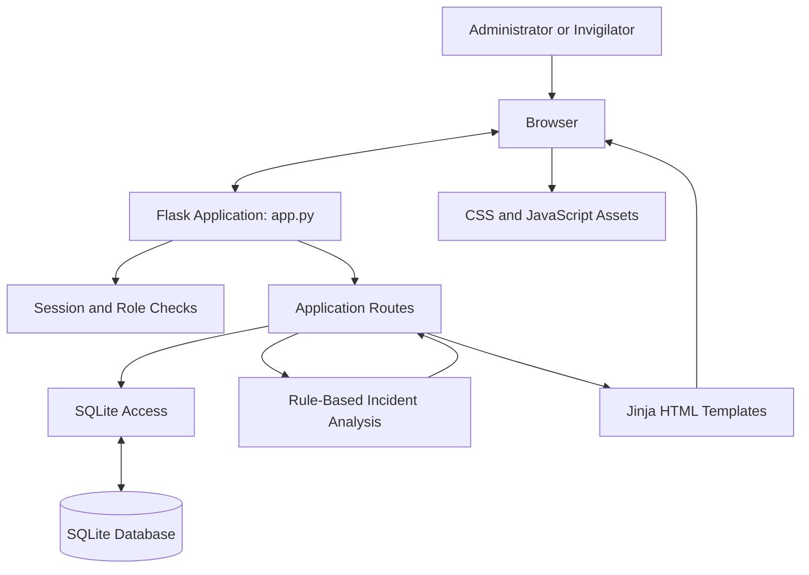

# Examination Integrity Management System (EIMS)

A Flask and SQLite web application for managing examination records, invigilator workflows, incident reports, and transparent rule-based incident summaries.

**Project type:** Academic / demonstration project  
**Stack:** Python · Flask · SQLite · HTML · CSS · JavaScript  
**Repository:** [Moana-star/AI_INTEGRITY](https://github.com/Moana-star/AI_INTEGRITY)

> **Important:** This is an academic demonstration, not a production-ready institutional platform. Seeded records are synthetic. The review categories are rule-based indicators—not predictions, proof of misconduct, or automated disciplinary decisions. Do not enter real student or institutional data.

## Contents

- [Overview](#overview)
- [Features](#features)
- [Architecture](#architecture)
- [Technology stack](#technology-stack)
- [Setup and installation](#setup-and-installation)
- [Demonstration accounts](#demonstration-accounts)
- [Incident review categories](#incident-review-categories)
- [Security and limitations](#security-and-limitations)
- [Testing](#testing)
- [Institutional development](#institutional-development)
- [Future improvements](#future-improvements)
- [Author](#author)

## Overview

The Examination Integrity Management System (EIMS) demonstrates how a web application can support examination administration. It provides separate administrator and invigilator workflows, stores structured records in SQLite, and gives administrators a consolidated view of examinations and reported incidents.

The analysis feature applies explicit rules to recorded incident data. Despite the interface's AI-analysis wording, **the current implementation does not use artificial intelligence, machine learning, or a trained predictive model**.

## Features

- **Role-aware sign-in:** administrator and invigilator accounts have different application areas.
- **Invigilator registration:** self-registration is restricted to the invigilator role.
- **Student management:** maintain student records used by examination and incident workflows.
- **Institutional student registry (initial increment):** maintain admission-number-based profiles, academic placement, institutional contact fields, and academic status; import authorized UTF-8 CSV records.
- **Registry foundations:** additive profile, academic-unit, enrolment, attendance, and audit-event schema foundations. Not all corresponding workflows are implemented yet.
- **Examination management:** manage examination details, schedules, venues, statuses, and invigilator assignments.
- **Invigilator management:** maintain invigilator details and status.
- **Incident reporting:** record incidents against students and examinations, including descriptions, severity, and status.
- **Incident review:** administrators can review incidents and mark them as resolved.
- **Explainable incident analysis:** categorize recorded incident patterns using explicit rules and show a reason for each category.
- **Dashboards and reports:** present examination, incident, and record summaries.
- **Local persistence:** store application data in SQLite.

## Architecture

The application uses a simple Flask server-rendered architecture:



This is a high-level view of the current codebase, not a production deployment diagram.

### Repository structure

```text
AI_INTEGRITY/
├── app.py                    # Flask routes and application logic
├── requirements.txt          # Python dependency declaration
├── database/
│   └── database.py           # SQLite schema and demo-data seeding
├── modules/
│   └── institutional_registry.py # Institutional student registry blueprint
├── docs/
│   ├── ARCHITECTURE.md       # Architecture notes
│   ├── DATA_GOVERNANCE.md    # Privacy and biometric safeguards
│   ├── INSTITUTIONAL_ROADMAP.md # Phased institutional development
│   └── TESTING.md            # Automated and manual test guidance
├── tests/
│   └── test_institutional_registry.py
├── .github/workflows/
│   └── tests.yml             # Python test workflow
├── static/
│   ├── css/style.css
│   └── js/auth.js
├── templates/                # Jinja/HTML pages
└── .gitignore
```

The SQLite database is generated locally during setup and is intentionally excluded from Git.

## Technology stack

| Technology | Purpose |
|---|---|
| Python | Application language |
| Flask | Web framework and routing |
| SQLite | Relational data storage |
| Werkzeug | Password hashing and Flask utilities |
| HTML / Jinja | Server-rendered pages |
| CSS | User-interface styling |
| JavaScript | Browser-side interactions |

## Setup and installation

### Prerequisites

- Python 3.9 or newer
- pip
- Git

### 1. Clone the repository

```bash
git clone https://github.com/Moana-star/AI_INTEGRITY.git
cd AI_INTEGRITY
```

### 2. Create and activate a virtual environment

**Windows PowerShell**

```powershell
python -m venv v
.\v\Scripts\Activate.ps1
```

If PowerShell blocks activation, use Command Prompt:

```cmd
v\Scripts\activate.bat
```

Alternatively, use the virtual environment's Python executable directly:

```powershell
.\v\Scripts\python.exe -m pip install -r requirements.txt
```

### 3. Install dependencies

```bash
python -m pip install --upgrade pip
python -m pip install -r requirements.txt
```

### 4. Configure local environment variables

Set a secret key and unique passwords for the optional demonstration accounts before initializing the database.

**Windows PowerShell**

```powershell
$env:FLASK_SECRET_KEY = (python -c "import secrets; print(secrets.token_hex(32))")
$env:DEMO_ADMIN_PASSWORD = "Choose-A-Strong-Local-Password"
$env:DEMO_INVIGILATOR_PASSWORD = "Choose-Another-Strong-Password"
```

Replace the example passwords with strong, unique values. These variables apply only to the current terminal session. Never commit real credentials or secret keys.

### 5. Initialize the database

From the repository root:

```bash
python database/database.py
```

The script creates the schema and inserts synthetic demonstration records in `database/exam_integrity.db`. The database file is excluded from version control.

**Existing database note:** Demo accounts are inserted only when their usernames do not already exist. If you need a fresh local demo database, back up anything you need first. The following command permanently deletes the local database and its contents before recreating it:

```powershell
Remove-Item .\database\exam_integrity.db
python database/database.py
```

Do not run this command if you need to preserve existing records.

### 6. Start the application

```bash
python app.py
```

Open the local URL printed in the terminal. The default Flask development address is usually [http://127.0.0.1:5000](http://127.0.0.1:5000).

For local development only, debug mode can be enabled in PowerShell:

```powershell
$env:FLASK_DEBUG = "1"
python app.py
```

Never enable Flask debug mode on a public or production deployment.

## Demonstration accounts

If the corresponding environment variables are set **before** database initialization, the setup script creates:

| Role | Username | Password |
|---|---|---|
| Administrator | `admin` | Value assigned to `DEMO_ADMIN_PASSWORD` |
| Invigilator | `jkamau` | Value assigned to `DEMO_INVIGILATOR_PASSWORD` |

Passwords are not stored in this repository. If these usernames already exist, `INSERT OR IGNORE` does not replace their existing passwords. Invigilators can also register through the registration page.

Use these accounts only in a local demonstration environment.

## Incident review categories

The current analysis function groups students with recorded incidents and assigns a review category using the following rules:

| Rule | Category |
|---|---|
| One or more high-severity incidents | **Critical** |
| Two or more incidents, with no high-severity incident | **High** |
| One lower-severity incident | **Watch** |

The application provides a short explanation for each category. These labels do not establish whether an incident occurred as alleged, determine intent, establish guilt, or replace a fair institutional review. Records must be assessed in context by an authorized person.

## Security and limitations

This repository is intended for learning and demonstration. A dedicated security and operational review is required before any real-world use.

- **Password storage:** passwords are stored using Werkzeug password hashing.
- **Database access:** the inspected application code uses parameterized SQL queries.
- **Session secret:** configure `FLASK_SECRET_KEY` with a strong private value. The random fallback in the code is not suitable for stable production sessions across restarts.
- **Password recovery:** the current forgot/reset-password experience is a local demonstration flow. It does not send a verified recovery email or establish account ownership; it is not secure production account recovery.
- **Request protection:** implement and verify CSRF protection for state-changing forms before public deployment.
- **Hosting:** a real deployment needs HTTPS, a production WSGI server, secure environment configuration, backups, monitoring, and an appropriately managed database.
- **Privacy:** do not use real student information in this demonstration. Institutional use would require authorization, privacy safeguards, retention rules, auditability, and human review.
- **Testing:** a manual checklist is provided, but it is not evidence that every test has passed.

## Testing

See [docs/TESTING.md](docs/TESTING.md) for manual checks covering setup, authentication, role access, record workflows, incident handling, and analysis. No automated test suite is currently included.

## Institutional development

The institutional direction, phased implementation status, and data-governance boundaries are documented here:

- [Institutional development roadmap](docs/INSTITUTIONAL_ROADMAP.md)
- [Data governance and biometric safeguards](docs/DATA_GOVERNANCE.md)

The first institutional-registry increment is available on the `feature/institutional-eims-foundation` branch. It adds a separate registry interface while preserving the existing student-management routes and legacy student records. The registry creates additive profile and operational schema tables when first accessed.

**Important boundaries:** this increment does not connect to a university student information system, validate official student data, complete unit registration or attendance workflows, or perform facial recognition. The attendance table is a schema foundation only. No face images, embeddings, biometric templates, or liveness recordings are collected. Do not use real student records until institutional authorization, security controls, privacy governance, and a controlled pilot are complete.

## Future improvements

- Automated unit and integration tests.
- CSRF protection and stronger input validation.
- Verified account recovery using secure, expiring reset tokens.
- Audit logs for important administrative actions.
- Database migrations and backup/restore procedures.
- Configurable review rules and governance controls.
- Accessibility and usability testing.
- Production deployment documentation and monitoring.

## Author

**Moana-star**  
[GitHub profile](https://github.com/Moana-star)

---

*An academic software project demonstrating Flask web development, relational data management, role-aware workflows, and explainable rule-based analysis.*
