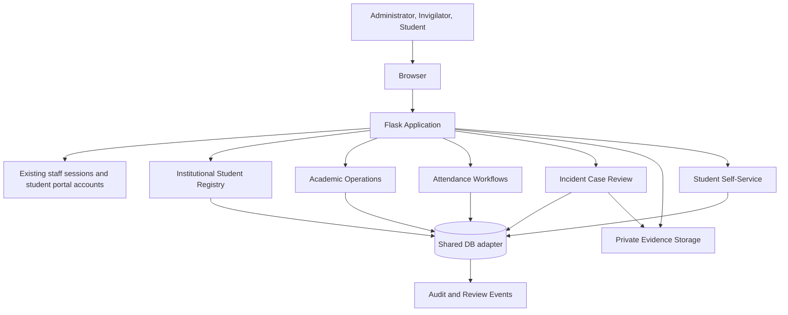

# EIMS Architecture

## Current development architecture

The feature branch uses a modular Flask application with server-rendered Jinja templates and a shared database access layer. SQLite is the local-development default; PostgreSQL connections are routed through psycopg using DATABASE_URL and are covered by a dedicated runtime integration job.

## Module responsibilities

| Module | Responsibility |
|---|---|
| `app.py` | Flask application, existing legacy routes, staff authentication and blueprint registration |
| `modules/institutional_registry.py` | Admission-number-based student profiles, CSV import and profile audit events |
| `modules/operations.py` | Academic units, enrolments, venues, examination sessions, candidate lists, seat labels, invigilator assignments and attendance |
| `modules/integrity.py` | Incident case workflow, review history, evidence upload/download and evidence audit events |
| `modules/student_portal.py` | Student account provisioning, authentication, academic/exam views, password change and incident responses |
| `database/database.py` | Empty-first local schema initialization; synthetic seed data requires explicit `--demo` |
| `templates/` | Server-rendered user interfaces |
| `static/` | CSS and browser-side JavaScript |

## Data flow

1. An authorized administrator creates or imports a student record. Admission number is unique.
2. The administrator creates academic units and registers active students for a unit by academic year and semester.
3. The administrator creates an examination session linked to an existing examination and optionally to an academic unit.
4. Candidate records are derived from active enrolments for the matching academic year and semester.
5. The venue capacity is checked against the derived candidate count. Seat labels are assigned sequentially.
6. An administrator assigns invigilators to the session.
7. Assigned invigilators record student-card or manual identity checks and check-in/check-out events.
8. Student portal users see only their own profile, enrolments, candidate sessions, attendance and incident notices.
9. An authorized reviewer manages incident workflow statuses, records review notes and requests a student response.
10. Students can submit one response to an incident when a response has been requested. Evidence is stored outside the public static directory and checksummed.

## Database strategy

All application modules now obtain connections through `modules/database.py`. SQLite remains the default when DATABASE_URL is unset; a PostgreSQL URL selects psycopg. The adapter translates the SQLite-compatible query patterns used by the application, and module schema initialization is exercised against PostgreSQL in CI.

PostgreSQL runtime support is under active validation and must not be considered production-certified until full role-based E2E, concurrency, backup/restore, security and institutional acceptance gates pass. The tested migration utility copies a consistent SQLite snapshot; production cutover still requires rehearsals and a rollback plan.

## Identity verification boundary

Attendance supports manual document checks and recording that a student card was checked. The system does not currently scan cards, read QR/barcodes, capture faces, compare biometric templates or perform liveness detection. A biometric provider adapter and institutional approval are prerequisites for any face verification pilot.

## Security boundary

The current code has password hashing for provisioned student accounts and existing staff accounts, role checks on new workflows, private evidence storage and selected audit records. It does not yet implement full institutional RBAC, CSRF protection, MFA, login rate limiting, encrypted evidence storage, malware scanning, automated retention or production monitoring. See [Production Readiness](PRODUCTION_READINESS.md).
