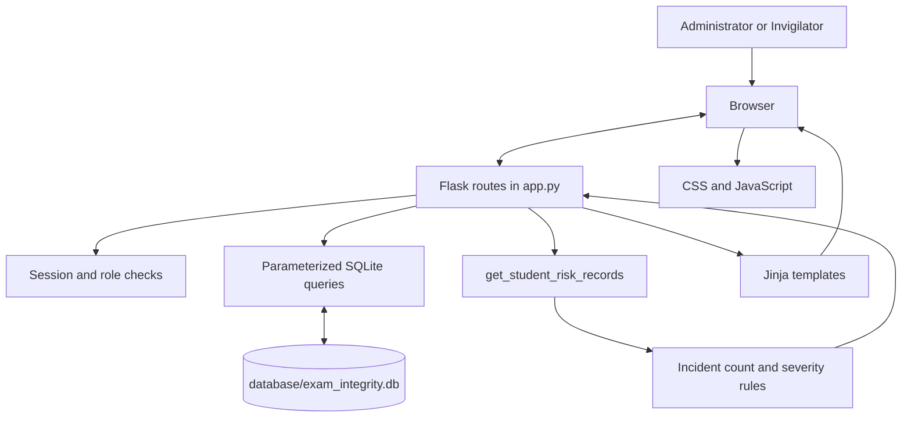

# EIMS Architecture

## Purpose

This document describes the current high-level structure of the Examination Integrity Management System. It reflects the Flask and SQLite code in this repository; it is not a production deployment specification.

## Request and data flow

## Main responsibilities

| Component | Responsibility |
|---|---|
| `app.py` | Flask setup, routes, session handling, role checks, and request-level application logic |
| `database/database.py` | SQLite table creation and synthetic demonstration-data seeding |
| `database/exam_integrity.db` | Local runtime database generated during setup; excluded from Git |
| `templates/` | Server-rendered HTML/Jinja pages |
| `static/css/` | Application styling |
| `static/js/` | Browser-side JavaScript |

## Data model

The database setup defines five main tables:

- `users`: usernames, password hashes, and roles.
- `students`: student identifiers and academic details.
- `invigilators`: invigilator details and optional links to user accounts.
- `examinations`: course, schedule, venue, status, and assigned invigilator.
- `incidents`: incident description, severity, status, and links to a student and examination.

Foreign-key relationships are declared in the schema. The Flask application's database connection enables SQLite foreign-key enforcement for application connections.

## Incident analysis

The `get_student_risk_records` function aggregates incident counts by student and assigns a category:

1. One or more high-severity incidents → Critical.
2. Otherwise, two or more incidents → High.
3. Otherwise, one recorded incident → Watch.

This is deterministic rule-based categorization. It is not a machine-learning model and should only be interpreted as a prompt for human review.
